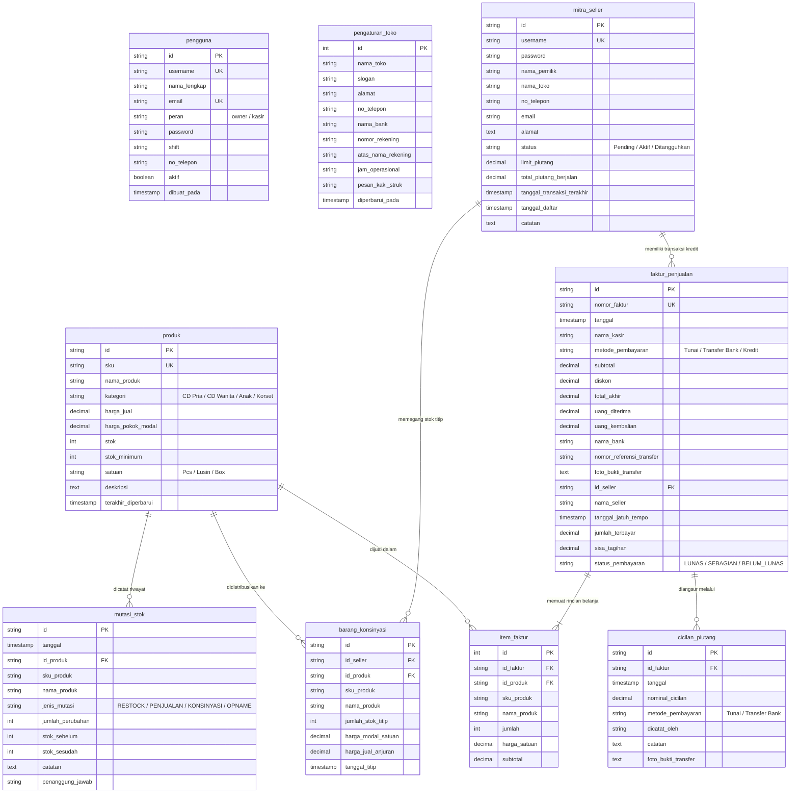
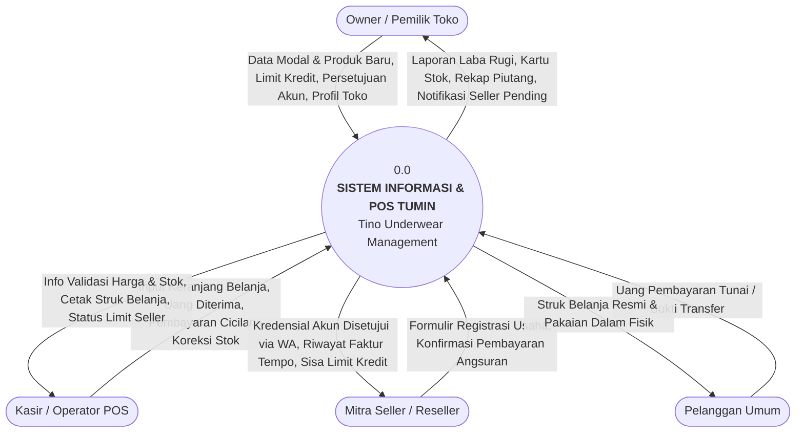
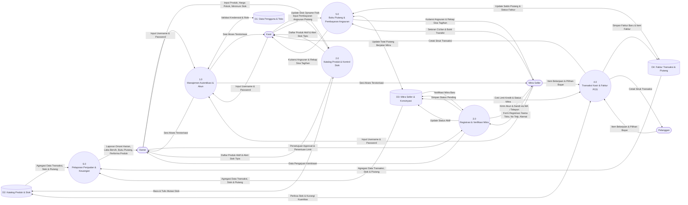
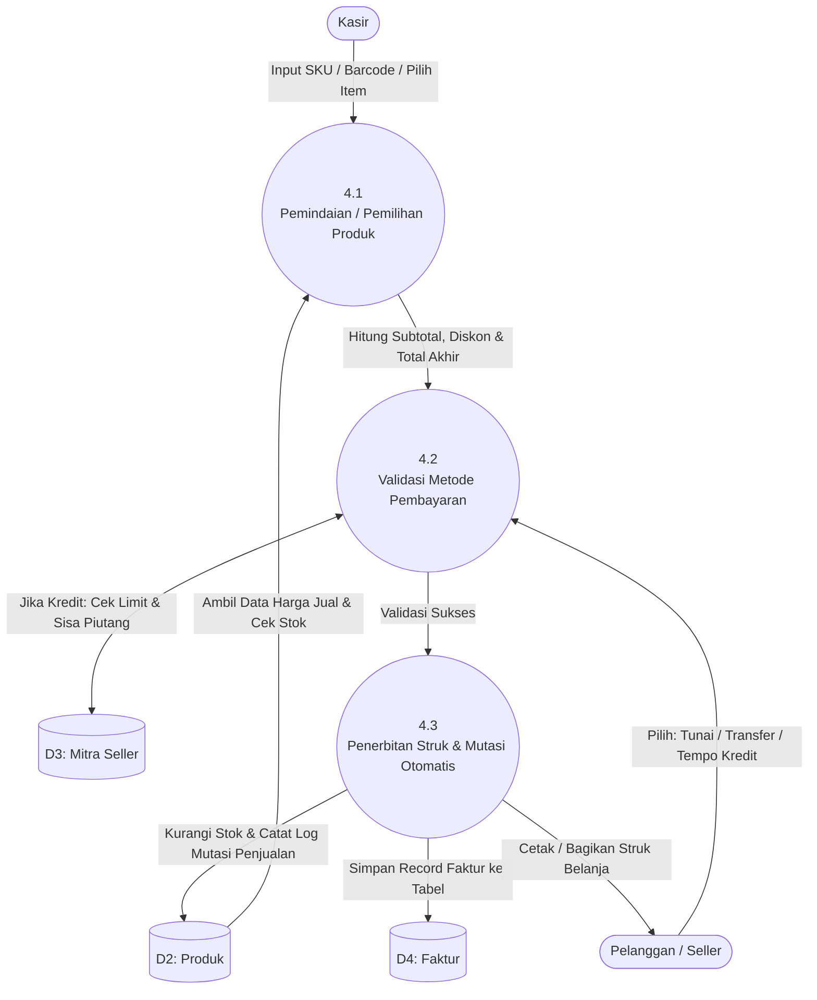

# Dokumentasi Perancangan Sistem: ERD & DFD
## Proyek Capstone: TUMIN (Tino Underwear Management & POS System)

Dokumen ini disusun untuk melengkapi laporan teknis dan pengujian Capstone Project, mencakup perancangan basis data relasional (**Entity Relationship Diagram - ERD**) dan pemodelan aliran data berjenjang (**Data Flow Diagram - DFD** Level 0 Context Diagram, Level 1, dan Level 2).

---

# BAGIAN 1: ENTITY RELATIONSHIP DIAGRAM (ERD)

## 1.1 Diagram Konseptual & Relasi (Mermaid Format)
*Catatan: Diagram di bawah ini akan otomatis dirender secara visual saat dibuka di GitHub.*



## 1.2 Kardinalitas dan Relasi Antar Entitas (Business Rules)
1. **`mitra_seller` ke `faktur_penjualan` (One-to-Many / 1 : N)**:
   - Satu mitra seller dapat memiliki banyak faktur penjualan tempo/kredit.
   - Satu faktur tempo hanya dimiliki oleh tepat satu mitra seller.
2. **`faktur_penjualan` ke `item_faktur` (One-to-Many / 1 : N)**:
   - Satu faktur penjualan memiliki satu atau lebih rincian barang belanjaan.
3. **`produk` ke `item_faktur` (One-to-Many / 1 : N)**:
   - Satu produk katalog dapat terjual berulang kali pada banyak transaksi.
4. **`faktur_penjualan` ke `cicilan_piutang` (One-to-Many / 1 : N)**:
   - Satu faktur tempo yang belum lunas dapat memiliki banyak riwayat catatan angsuran pembayaran hingga sisa saldo menjadi Rp 0.
5. **`mitra_seller` ke `barang_konsinyasi` (One-to-Many / 1 : N)**:
   - Satu mitra reseller dapat membawa banyak item titipan konsinyasi produk toko.
6. **`produk` ke `mutasi_stok` (One-to-Many / 1 : N)**:
   - Setiap perubahan stok produk (penjualan kasir, restock suplier, koreksi opname) mencatat kartu riwayat mutasi audit untuk integritas inventori.

---

# BAGIAN 2: DATA FLOW DIAGRAM (DFD)

Sistem Informasi & POS TUMIN dirancang untuk mengintegrasikan proses operasional toko fisik grosir/eceran pakaian dalam dengan pemantauan terpusat oleh pemilik (*Owner*).

## 2.1 Entitas Eksternal (External Entities / Terminator)
1. **Owner (Pemilik Toko)**: Memiliki hak akses penuh untuk mengelola harga dasar modal, penetapan limit kredit mitra, verifikasi persetujuan pendaftaran mitra seller via WhatsApp, konfigurasi toko, dan analisis laporan keuangan komprehensif.
2. **Kasir (Operator POS)**: Mengoperasikan modul transaksi kasir harian, melayani penjualan tunai/transfer/kredit tempo, menerima cicilan piutang seller, dan melakukan stok opname fisik.
3. **Mitra Seller (Reseller / Pembeli Grosir Tempo)**: Mengajukan formulir kemitraan, menerima konfirmasi akun yang disetujui dari Owner, mengambil stok barang konsinyasi/tempo, dan menyetor angsuran pelunasan.
4. **Pelanggan Umum (Customer Eceran)**: Melakukan transaksi pembelian langsung di meja kasir dan menerima struk belanja fisik/digital.

---

## 2.2 DFD Level 0 (Diagram Konteks / Context Diagram)

Diagram konteks menggambarkan batasan sistem (*system boundary*) secara garis besar dengan seluruh entitas luar yang berinteraksi.



---

## 2.3 DFD Level 1 (Dekomposisi Proses Sistem)

Membagi sistem ke dalam 6 proses utama serta interaksinya dengan 4 kelompok Data Store (Penyimpanan Data).



---

## 2.4 DFD Level 2 (Rincian Proses Kritis)

### A. DFD Level 2 - Proses 3.0: Registrasi & Verifikasi Mitra Seller
```mermaid
flowchart TD
    Seller([Mitra Seller])
    Owner([Owner Toko])
    D3[(D3: mitra_seller)]

    P31((3.1<br/>Penerimaan Formulir Pendaftaran))
    P32((3.2<br/>Verifikasi Kelaikan & Limit Piutang))
    P33((3.3<br/>Aktivasi Akun & Kontak WhatsApp))

    Seller -->|Isi Nama, Toko, No HP, Alamat, Usulan User/Pass| P31
    P31 -->|Simpan Data Status 'Pending'| D3

    D3 -->|Tampilkan Daftar Pengajuan Antrean| P32
    Owner -->|Review Profil, Tentukan Limit Kredit (Rp)| P32

    P32 -->|Keputusan Approval Disetujui| P33
    P33 -->|Update Status 'Aktif' di Database| D3
    P33 -->|Hubungi Seller via WA dengan Format Pesan Akun Siap Pakai| Seller
```

### B. DFD Level 2 - Proses 4.0: Transaksi Kasir POS


---

## 2.5 Kamus Data (Data Dictionary) Utama
* **Data Arus `Form_Registrasi_Seller`**: `nama_pemilik + nama_toko + no_telepon + alamat + usulan_username + usulan_password`
* **Data Arus `Faktur_Penjualan`**: `nomor_faktur + tanggal + nama_kasir + metode_bayar + {item_produk + kuantitas + harga_satuan + subtotal} + diskon + total_akhir + status_lunas`
* **Data Arus `Bukti_Angsuran_Piutang`**: `id_faktur + tanggal_bayar + nominal_cicilan + metode_bayar + dicatat_oleh + sisa_saldo_terbaru`
* **Data Arus `Laporan_Keuangan`**: `periode_tanggal + total_omzet_kotor + total_hpp_modal + laba_kotor + total_piutang_berjalan + stok_aset_tersedia`

---
*Dokumen ini merupakan bagian dari berkas arsitektur proyek Capstone TUMIN (Tino Underwear Management & POS System).*
