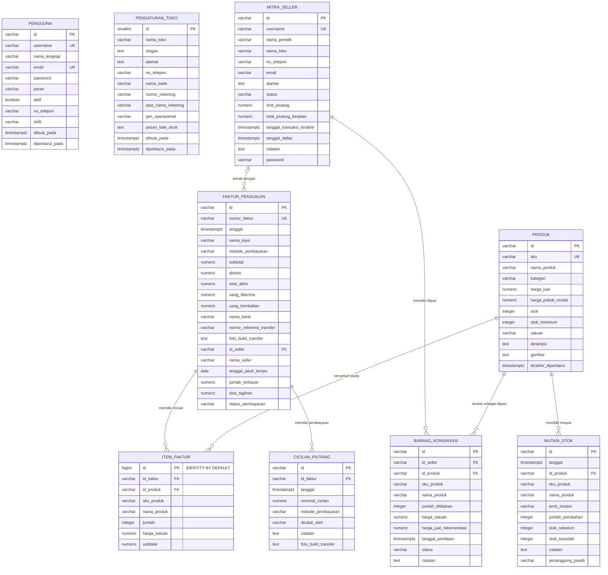
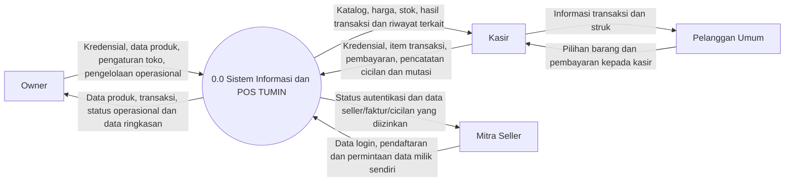
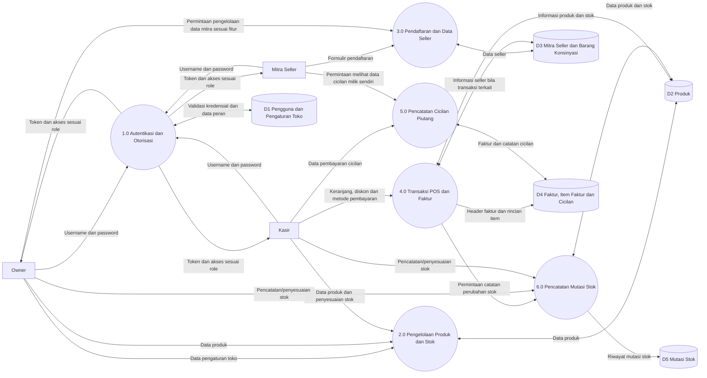
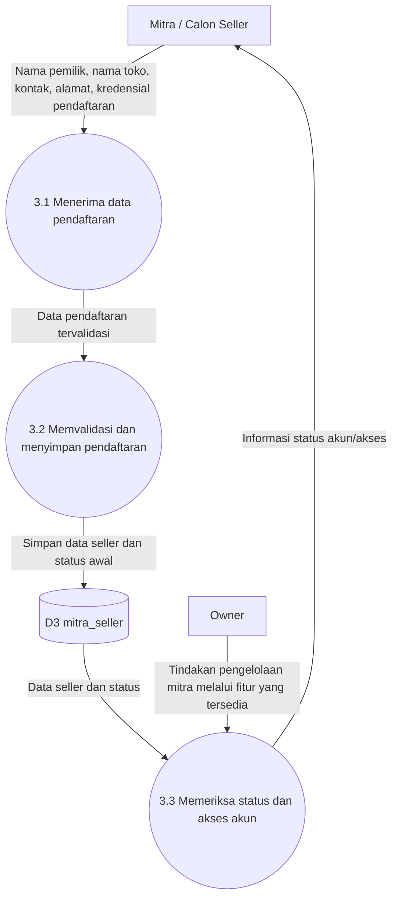
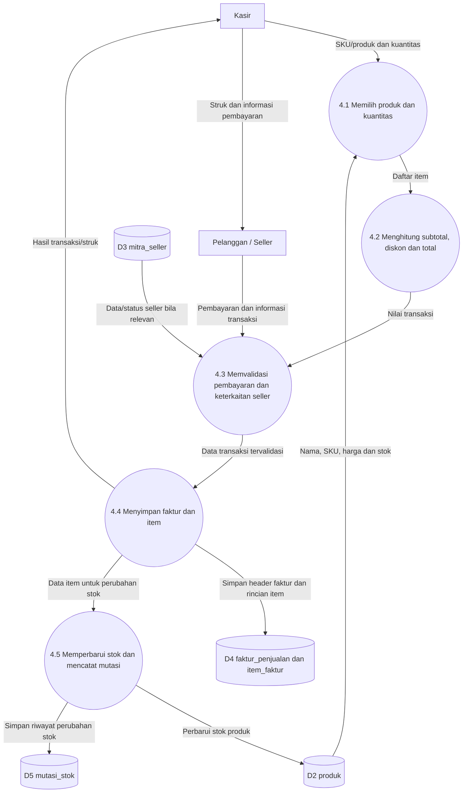
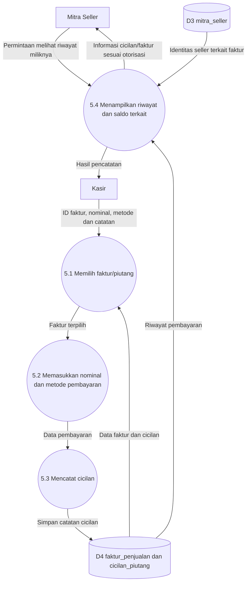

# DOKUMENTASI PERANCANGAN SISTEM: ERD & DFD

## Proyek Capstone TUMIN (Tino Underwear UMK Integration)

**Versi dokumentasi:** Revisi berdasarkan skema PostgreSQL `tumin_db_v2` dan pemeriksaan kode backend `server.ts`
**Teknologi utama:** React 19, Vite, Express.js, TypeScript, PostgreSQL, Node.js 24
**Tujuan dokumen:** Menjelaskan struktur basis data aktual (ERD), aliran data sistem (DFD), aturan bisnis, serta batasan integrasi yang perlu diketahui saat pengujian dan presentasi.

> **Catatan metodologi:** ERD pada dokumen ini mengikuti struktur database `tumin_db_v2` yang diperiksa melalui `information_schema` dan constraint PostgreSQL. DFD dibedakan antara alur yang telah didukung endpoint backend dan alur/fitur yang masih perlu integrasi atau verifikasi frontend. Keberadaan tabel tidak otomatis berarti seluruh fitur terkait sudah terintegrasi end-to-end.

---

# BAGIAN 1 — ENTITY RELATIONSHIP DIAGRAM (ERD)

## 1.1 Ringkasan Struktur Database

Database `tumin_db_v2` memiliki **9 tabel**:

1. `pengguna`
2. `pengaturan_toko`
3. `produk`
4. `mitra_seller`
5. `barang_konsinyasi`
6. `faktur_penjualan`
7. `item_faktur`
8. `cicilan_piutang`
9. `mutasi_stok`

Seluruh tabel memiliki primary key. Database memiliki tujuh foreign key yang menghubungkan tabel transaksi, produk, seller, dan pencatatan stok. Constraint UNIQUE yang terverifikasi terdapat pada username/email pengguna, username seller, SKU produk, dan nomor faktur.

## 1.2 ERD Aktual — Mermaid

Diagram berikut menampilkan sembilan entitas dan seluruh relasi foreign key yang terverifikasi pada `tumin_db_v2`.

**Interpretasi kardinalitas:**

- `||--o{`: satu record induk dapat berhubungan dengan nol atau banyak record anak; setiap record anak merujuk ke satu record induk melalui foreign key.
- `o|--o{` pada `MITRA_SELLER`–`FAKTUR_PENJUALAN`: kolom `faktur_penjualan.id_seller` bersifat nullable. Dengan demikian, satu faktur dapat tidak terkait seller (misalnya transaksi pelanggan umum) atau terkait dengan satu seller; satu seller dapat terkait dengan banyak faktur.
- Foreign key memastikan referensi record yang terkait, tetapi tidak memaksa setiap record induk memiliki record anak.

## 1.3 Atribut dan Tipe Data Aktual

Keterangan: `NOT NULL` berarti kolom wajib diisi. `NULL` berarti kolom boleh kosong. Panjang `varchar(n)` mengikuti batas karakter yang terdeteksi pada database.

### A. Tabel `pengguna`

| Kolom | Tipe data | Null | Keterangan |
|---|---|---:|---|
| `id` | varchar(80) | Tidak | Primary key |
| `username` | varchar(80) | Tidak | Unique |
| `nama_lengkap` | varchar(160) | Tidak | Nama pengguna |
| `email` | varchar(254) | Ya | Unique jika diisi |
| `password` | varchar(255) | Tidak | Penyimpanan hash kata sandi |
| `peran` | varchar(20) | Tidak | Peran pengguna, misalnya owner/kasir |
| `aktif` | boolean | Tidak | Default `true` |
| `no_telepon` | varchar(30) | Ya | Nomor telepon |
| `shift` | varchar(40) | Ya | Informasi shift |
| `dibuat_pada` | timestamptz | Tidak | Default `CURRENT_TIMESTAMP` |
| `diperbarui_pada` | timestamptz | Tidak | Default `CURRENT_TIMESTAMP` |

### B. Tabel `pengaturan_toko`

| Kolom | Tipe data | Null | Keterangan |
|---|---|---:|---|
| `id` | smallint | Tidak | Primary key; default `1` |
| `nama_toko` | varchar(200) | Tidak | Default `TUMIN` |
| `slogan` | text | Ya | Slogan toko |
| `alamat` | text | Ya | Alamat toko |
| `no_telepon` | varchar(30) | Ya | Kontak toko |
| `nama_bank` | varchar(100) | Ya | Nama bank |
| `nomor_rekening` | varchar(100) | Ya | Nomor rekening |
| `atas_nama_rekening` | varchar(160) | Ya | Pemilik rekening |
| `jam_operasional` | varchar(160) | Ya | Jam operasional |
| `pesan_kaki_struk` | text | Ya | Footer struk |
| `dibuat_pada` | timestamptz | Tidak | Default `CURRENT_TIMESTAMP` |
| `diperbarui_pada` | timestamptz | Tidak | Default `CURRENT_TIMESTAMP` |

### C. Tabel `produk`

| Kolom | Tipe data | Null | Keterangan |
|---|---|---:|---|
| `id` | varchar(80) | Tidak | Primary key |
| `sku` | varchar(80) | Tidak | Unique |
| `nama_produk` | varchar(200) | Tidak | Nama produk |
| `kategori` | varchar(100) | Tidak | Kategori produk |
| `harga_jual` | numeric | Tidak | Harga jual |
| `harga_pokok_modal` | numeric | Tidak | Default `0` |
| `stok` | integer | Tidak | Default `0` |
| `stok_minimum` | integer | Tidak | Default `0` |
| `satuan` | varchar(40) | Tidak | Default `Pcs` |
| `deskripsi` | text | Ya | Deskripsi produk |
| `gambar` | text | Ya | Referensi/isi gambar produk |
| `terakhir_diperbarui` | timestamptz | Tidak | Default `CURRENT_TIMESTAMP` |

### D. Tabel `mitra_seller`

| Kolom | Tipe data | Null | Keterangan |
|---|---|---:|---|
| `id` | varchar(80) | Tidak | Primary key |
| `username` | varchar(80) | Ya | Unique jika diisi |
| `nama_pemilik` | varchar(160) | Tidak | Nama pemilik usaha |
| `nama_toko` | varchar(160) | Tidak | Nama toko mitra |
| `no_telepon` | varchar(30) | Tidak | Nomor telepon |
| `email` | varchar(254) | Ya | Email mitra |
| `alamat` | text | Ya | Alamat mitra |
| `status` | varchar(30) | Tidak | Default `Pending` |
| `limit_piutang` | numeric | Tidak | Default `5000000` |
| `total_piutang_berjalan` | numeric | Tidak | Default `0` |
| `tanggal_transaksi_terakhir` | timestamptz | Ya | Transaksi terakhir |
| `tanggal_daftar` | timestamptz | Tidak | Default `CURRENT_TIMESTAMP` |
| `catatan` | text | Ya | Catatan mitra |
| `password` | varchar(255) | Ya | Hash kata sandi seller bila akun dibuat |

### E. Tabel `barang_konsinyasi`

| Kolom | Tipe data | Null | Keterangan |
|---|---|---:|---|
| `id` | varchar(100) | Tidak | Primary key |
| `id_seller` | varchar(80) | Tidak | FK ke `mitra_seller.id` |
| `id_produk` | varchar(80) | Tidak | FK ke `produk.id` |
| `sku_produk` | varchar(80) | Tidak | Snapshot SKU produk |
| `nama_produk` | varchar(200) | Tidak | Snapshot nama produk |
| `jumlah_dititipkan` | integer | Tidak | Jumlah barang yang dititipkan |
| `harga_satuan` | numeric | Tidak | Harga satuan |
| `harga_jual_rekomendasi` | numeric | Tidak | Harga jual rekomendasi |
| `tanggal_penitipan` | timestamptz | Tidak | Default `CURRENT_TIMESTAMP` |
| `status` | varchar(30) | Tidak | Default `DITITIPKAN` |
| `catatan` | text | Ya | Catatan penitipan |

### F. Tabel `faktur_penjualan`

| Kolom | Tipe data | Null | Keterangan |
|---|---|---:|---|
| `id` | varchar(100) | Tidak | Primary key |
| `nomor_faktur` | varchar(100) | Tidak | Unique |
| `tanggal` | timestamptz | Tidak | Default `CURRENT_TIMESTAMP` |
| `nama_kasir` | varchar(160) | Tidak | Nama kasir |
| `metode_pembayaran` | varchar(40) | Tidak | Metode pembayaran |
| `subtotal` | numeric | Tidak | Subtotal transaksi |
| `diskon` | numeric | Tidak | Default `0` |
| `total_akhir` | numeric | Tidak | Total setelah diskon |
| `uang_diterima` | numeric | Ya | Nominal diterima |
| `uang_kembalian` | numeric | Ya | Kembalian |
| `nama_bank` | varchar(100) | Ya | Bank transfer |
| `nomor_referensi_transfer` | varchar(160) | Ya | Referensi transfer |
| `foto_bukti_transfer` | text | Ya | Bukti transfer |
| `id_seller` | varchar(80) | Ya | FK ke `mitra_seller.id`; nullable |
| `nama_seller` | varchar(160) | Ya | Nama seller pada faktur |
| `tanggal_jatuh_tempo` | date | Ya | Tanggal jatuh tempo |
| `jumlah_terbayar` | numeric | Tidak | Default `0` |
| `sisa_tagihan` | numeric | Tidak | Default `0` |
| `status_pembayaran` | varchar(20) | Tidak | Default `LUNAS` |

### G. Tabel `item_faktur`

| Kolom | Tipe data | Null | Keterangan |
|---|---|---:|---|
| `id` | bigint | Tidak | Primary key; `GENERATED BY DEFAULT AS IDENTITY` |
| `id_faktur` | varchar(100) | Tidak | FK ke `faktur_penjualan.id` |
| `id_produk` | varchar(80) | Tidak | FK ke `produk.id` |
| `sku_produk` | varchar(80) | Tidak | Snapshot SKU produk |
| `nama_produk` | varchar(200) | Tidak | Snapshot nama produk |
| `jumlah` | integer | Tidak | Kuantitas |
| `harga_satuan` | numeric | Tidak | Harga per unit saat transaksi |
| `subtotal` | numeric | Tidak | Subtotal item |

**Catatan identity:** `item_faktur.id` menggunakan identity column dengan mode `BY DEFAULT`. PostgreSQL menghasilkan nilai ID otomatis jika INSERT tidak menyertakan nilai ID. Nilai manual tetap dapat diberikan bila diperlukan.

### H. Tabel `cicilan_piutang`

| Kolom | Tipe data | Null | Keterangan |
|---|---|---:|---|
| `id` | varchar(100) | Tidak | Primary key |
| `id_faktur` | varchar(100) | Tidak | FK ke `faktur_penjualan.id` |
| `tanggal` | timestamptz | Tidak | Default `CURRENT_TIMESTAMP` |
| `nominal_cicilan` | numeric | Tidak | Nominal pembayaran cicilan |
| `metode_pembayaran` | varchar(40) | Tidak | Metode pembayaran |
| `dicatat_oleh` | varchar(160) | Tidak | Pencatat pembayaran |
| `catatan` | text | Ya | Catatan |
| `foto_bukti_transfer` | text | Ya | Bukti transfer |

### I. Tabel `mutasi_stok`

| Kolom | Tipe data | Null | Keterangan |
|---|---|---:|---|
| `id` | varchar(120) | Tidak | Primary key |
| `tanggal` | timestamptz | Tidak | Default `CURRENT_TIMESTAMP` |
| `id_produk` | varchar(80) | Tidak | FK ke `produk.id` |
| `sku_produk` | varchar(80) | Tidak | Snapshot SKU produk |
| `nama_produk` | varchar(200) | Tidak | Snapshot nama produk |
| `jenis_mutasi` | varchar(40) | Tidak | Jenis perubahan stok |
| `jumlah_perubahan` | integer | Tidak | Besar perubahan stok |
| `stok_sebelum` | integer | Tidak | Stok sebelum perubahan |
| `stok_sesudah` | integer | Tidak | Stok setelah perubahan |
| `catatan` | text | Ya | Catatan mutasi |
| `penanggung_jawab` | varchar(160) | Tidak | Pelaksana perubahan |

## 1.4 Daftar Constraint yang Terverifikasi

### Primary Key

Masing-masing tabel memiliki primary key pada kolom `id`:

- `pengguna.id`
- `pengaturan_toko.id`
- `produk.id`
- `mitra_seller.id`
- `barang_konsinyasi.id`
- `faktur_penjualan.id`
- `item_faktur.id`
- `cicilan_piutang.id`
- `mutasi_stok.id`

### Foreign Key

| Tabel anak | Kolom FK | Tabel induk | Kolom referensi |
|---|---|---|---|
| `barang_konsinyasi` | `id_seller` | `mitra_seller` | `id` |
| `barang_konsinyasi` | `id_produk` | `produk` | `id` |
| `cicilan_piutang` | `id_faktur` | `faktur_penjualan` | `id` |
| `faktur_penjualan` | `id_seller` | `mitra_seller` | `id` |
| `item_faktur` | `id_faktur` | `faktur_penjualan` | `id` |
| `item_faktur` | `id_produk` | `produk` | `id` |
| `mutasi_stok` | `id_produk` | `produk` | `id` |

### Unique Constraint

| Tabel | Kolom | Tujuan |
|---|---|---|
| `pengguna` | `username` | Mencegah username pengguna duplikat |
| `pengguna` | `email` | Mencegah email pengguna duplikat jika diisi |
| `mitra_seller` | `username` | Mencegah username seller duplikat jika diisi |
| `produk` | `sku` | Menjaga SKU produk unik |
| `faktur_penjualan` | `nomor_faktur` | Menjaga nomor faktur unik |

> Pemeriksaan yang dilakukan memastikan jenis dan kolom constraint. Aturan `ON DELETE`, `ON UPDATE`, indeks tambahan, CHECK constraint, serta trigger belum dirinci dalam hasil pemeriksaan ini dan tidak diasumsikan dalam dokumen.

## 1.5 Aturan Bisnis dan Relasi

1. **Mitra seller dan faktur penjualan:** satu seller dapat terkait dengan banyak faktur. Karena `faktur_penjualan.id_seller` nullable, faktur pelanggan umum dapat tidak memiliki seller.
2. **Faktur penjualan dan item faktur:** satu faktur dapat memiliki sejumlah item faktur. Setiap item wajib mengacu pada satu faktur.
3. **Produk dan item faktur:** satu produk dapat tercatat pada banyak item faktur; setiap item faktur wajib mengacu pada satu produk.
4. **Faktur penjualan dan cicilan piutang:** satu faktur dapat memiliki nol atau banyak catatan cicilan. Setiap catatan cicilan wajib mengacu pada satu faktur.
5. **Mitra seller dan barang konsinyasi:** satu seller dapat memiliki nol atau banyak catatan penitipan. Setiap catatan penitipan wajib mengacu pada satu seller.
6. **Produk dan barang konsinyasi:** satu produk dapat muncul pada banyak catatan penitipan. Setiap catatan penitipan wajib mengacu pada satu produk.
7. **Produk dan mutasi stok:** satu produk dapat memiliki banyak catatan mutasi stok. Setiap mutasi wajib mengacu pada satu produk.

---

# BAGIAN 2 — DATA FLOW DIAGRAM (DFD)

## 2.1 Batasan dan Aktor Sistem

DFD menggambarkan pertukaran data antara aktor, proses aplikasi, dan penyimpanan data. Aktor yang berinteraksi dengan TUMIN:

1. **Owner:** mengelola pengaturan toko, data produk, data mitra, serta memantau transaksi dan informasi operasional sesuai fitur yang tersedia.
2. **Kasir:** mengelola transaksi POS, melihat data produk, mencatat pembayaran cicilan, dan mencatat mutasi stok sesuai hak akses.
3. **Mitra Seller:** mengajukan pendaftaran, login setelah akun memenuhi ketentuan aktivasi, serta melihat data miliknya sesuai hak akses.
4. **Pelanggan umum:** berinteraksi dengan kasir untuk pembelian barang dan pembayaran. Pelanggan umum bukan akun internal yang harus login ke aplikasi.

## 2.2 DFD Level 0 — Diagram Konteks

Diagram konteks menunjukkan pelanggan umum bertransaksi melalui kasir. Diagram tidak menyiratkan bahwa pelanggan umum memiliki akun aplikasi.

## 2.3 DFD Level 1 — Dekomposisi Proses

### Penjelasan proses Level 1

| Proses | Nama | Fungsi utama | Penyimpanan terkait |
|---|---|---|---|
| 1.0 | Autentikasi dan otorisasi | Login, validasi token, dan pembatasan hak akses berdasarkan role | `pengguna` |
| 2.0 | Pengelolaan produk dan stok | Membaca katalog serta membuat/memperbarui data produk dan stok | `produk` |
| 3.0 | Pendaftaran dan data seller | Menerima pendaftaran seller dan membaca data mitra sesuai hak akses | `mitra_seller` |
| 4.0 | Transaksi POS dan faktur | Mencatat faktur, rincian item, dan perubahan stok yang terkait transaksi | `faktur_penjualan`, `item_faktur`, `produk`, `mutasi_stok` |
| 5.0 | Pencatatan cicilan piutang | Membaca dan mencatat pembayaran cicilan serta keterkaitannya dengan faktur | `cicilan_piutang`, `faktur_penjualan` |
| 6.0 | Pencatatan mutasi stok | Membaca dan mencatat riwayat perubahan stok | `produk`, `mutasi_stok` |

**Catatan:** `pengaturan_toko` merupakan data store konfigurasi toko yang dibaca oleh proses aplikasi. `barang_konsinyasi` merupakan bagian skema database, tetapi integrasi penyimpanan fitur konsinyasi ke backend perlu diselesaikan/diverifikasi tersendiri.

## 2.4 DFD Level 2 — Proses 3.0 Pendaftaran Seller

Pendaftaran publik diproses dengan aturan backend yang memaksa status awal menjadi `Pending` untuk pendaftar publik dan menggunakan limit awal yang ditetapkan backend. Password seller disimpan dalam bentuk hash. Aktivasi atau perubahan status harus mengikuti mekanisme pengelolaan yang benar-benar tersedia pada versi aplikasi; jangan mengasumsikan notifikasi WhatsApp otomatis apabila tidak ada integrasi pengiriman pesan yang terverifikasi.

## 2.5 DFD Level 2 — Proses 4.0 Transaksi POS

Pada implementasi backend yang diperiksa, pembuatan faktur menggunakan transaksi database (`BEGIN`, `COMMIT`, dan `ROLLBACK`) untuk mengelola penyimpanan faktur, item, pengurangan stok, serta pencatatan mutasi sebagai satu rangkaian transaksi.

## 2.6 DFD Level 2 — Proses 5.0 Pembayaran Cicilan

Pencatatan cicilan dilakukan oleh role yang diizinkan backend. Akses seller terhadap data faktur dan cicilan dibatasi pada data yang terhubung dengan identitas seller dari token autentikasi.

---

# BAGIAN 3 — KETERKAITAN DFD DENGAN IMPLEMENTASI BACKEND

## 3.1 Inventaris Endpoint Backend yang Diperiksa

| Metode | Endpoint | Akses ringkas | Fungsi |
|---|---|---|---|
| GET | `/api/status` | Publik | Status server dan koneksi database |
| POST | `/api/auth/login` | Publik, rate-limited | Login dan penerbitan token |
| GET | `/api/auth/migration-status` | Owner | Status migrasi kredensial |
| GET | `/api/pengaturan` | Owner, Kasir, Seller | Membaca pengaturan toko |
| PUT | `/api/pengaturan` | Owner | Memperbarui pengaturan toko |
| GET | `/api/produk` | Owner, Kasir, Seller | Membaca katalog produk |
| POST | `/api/produk` | Owner, Kasir | Menambah/memperbarui produk |
| GET | `/api/mitra-seller` | Owner, Kasir, Seller dengan isolasi data | Membaca data mitra seller |
| POST | `/api/mitra-seller` | Pendaftaran publik dengan pembatasan; Owner dapat mengelola sesuai logika route | Pendaftaran seller |
| GET | `/api/faktur` dan `/api/transaksi` | Owner, Kasir, Seller dengan isolasi data | Membaca faktur/transaksi |
| POST | `/api/faktur` dan `/api/transaksi` | Owner, Kasir | Membuat faktur dan item transaksi |
| GET | `/api/cicilan` | Owner, Kasir, Seller dengan isolasi data | Membaca catatan cicilan |
| POST | `/api/cicilan` | Owner, Kasir | Mencatat cicilan |
| GET | `/api/mutasi-stok` | Owner, Kasir | Membaca riwayat mutasi stok |
| POST | `/api/mutasi-stok` | Owner, Kasir | Mencatat mutasi stok |

Endpoint di atas berasal dari pemeriksaan `server.ts` yang tersedia saat penyusunan dokumen. Jika kode berubah, inventaris endpoint dan aturan akses perlu diperbarui kembali.

## 3.2 Catatan Kesesuaian dan Batasan Integrasi

| Area | Temuan pada pemeriksaan | Implikasi dokumentasi |
|---|---|---|
| Autentikasi | Backend menyediakan login JWT dan middleware otorisasi role | DFD menampilkan proses autentikasi dan otorisasi |
| Produk | Backend menyediakan GET dan POST produk | Data produk dapat digambarkan sebagai proses backend/database |
| Mitra seller | Backend menyediakan GET dan POST pendaftaran seller | Jangan menggambarkan endpoint update/delete seller yang belum ditemukan pada inventaris route ini |
| Faktur POS | Backend menyediakan GET/POST faktur; POST mengelola item dan stok dalam transaksi database | DFD POS menggambarkan penyimpanan faktur, item, dan perubahan stok |
| Cicilan | Backend menyediakan GET/POST cicilan | Tabel cicilan ada dan memiliki relasi ke faktur |
| Mutasi stok | Backend menyediakan GET/POST mutasi stok | Riwayat mutasi dapat digambarkan sebagai proses backend |
| Konsinyasi | Tabel `barang_konsinyasi` ada pada database, tetapi audit frontend sebelumnya menemukan data konsinyasi disimpan di `localStorage`; belum ditemukan endpoint khusus konsinyasi pada inventaris route `server.ts` | Jangan menyatakan penyimpanan konsinyasi sudah persisten ke PostgreSQL sebelum integrasi diuji |
| Update data seller | Pada inventaris route `server.ts` yang diperiksa tidak ditemukan route PUT khusus `/api/mitra-seller/:id` | Fitur edit seller perlu diverifikasi/dilengkapi agar tidak hanya tampil di UI |
| Pengambilan cicilan pada faktur | Pemeriksaan sebelumnya menemukan endpoint faktur mengembalikan `installments: []` meskipun tabel cicilan tersedia | Integrasi tampilan riwayat cicilan pada detail faktur perlu diuji dan diselaraskan |
| Laporan | Tidak ditemukan endpoint laporan khusus dalam inventaris route backend yang diperiksa | Jangan mengklaim laporan keuangan dihasilkan oleh endpoint backend tanpa verifikasi implementasi frontend dan sumber datanya |
| Notifikasi WhatsApp | Tidak ada endpoint/integrasi pengiriman WhatsApp yang teridentifikasi pada inventaris route tersebut | WhatsApp tidak boleh digambarkan sebagai notifikasi otomatis sistem; bila dilakukan manual, tulis sebagai prosedur operasional manual |

**Penting:** tabel `barang_konsinyasi` sudah ada pada skema database dan memiliki dua foreign key. Namun, keberadaan tabel/relasi tidak sama dengan integrasi UI/API. Status integrasi perlu diuji secara terpisah.

---

# BAGIAN 4 — KAMUS DATA (DATA DICTIONARY) ALIRAN UTAMA

## 4.1 Data Pendaftaran Seller

- `nama_pemilik`
- `nama_toko`
- `no_telepon`
- `email` (opsional)
- `alamat` (opsional)
- `username` (opsional pada skema, sesuai alur pendaftaran)
- password mentah pada saat input yang kemudian diproses backend menjadi hash sebelum disimpan

## 4.2 Data Faktur Penjualan

- Identitas faktur: `id`, `nomor_faktur`, `tanggal`
- Informasi kasir: `nama_kasir`
- Pembayaran: `metode_pembayaran`, `uang_diterima`, `uang_kembalian`, `nama_bank`, `nomor_referensi_transfer`, `foto_bukti_transfer`
- Ringkasan nilai: `subtotal`, `diskon`, `total_akhir`
- Seller dan piutang: `id_seller`, `nama_seller`, `tanggal_jatuh_tempo`, `jumlah_terbayar`, `sisa_tagihan`, `status_pembayaran`
- Rincian item disimpan pada `item_faktur`: produk, SKU, nama produk, jumlah, harga satuan, subtotal

## 4.3 Data Pembayaran Cicilan

- `id_faktur`
- `tanggal`
- `nominal_cicilan`
- `metode_pembayaran`
- `dicatat_oleh`
- `catatan`
- `foto_bukti_transfer`

## 4.4 Data Mutasi Stok

- `id_produk`
- `tanggal`
- `sku_produk`
- `nama_produk`
- `jenis_mutasi`
- `jumlah_perubahan`
- `stok_sebelum`
- `stok_sesudah`
- `catatan`
- `penanggung_jawab`

## 4.5 Data Barang Konsinyasi

- `id_seller`
- `id_produk`
- `sku_produk`
- `nama_produk`
- `jumlah_dititipkan`
- `harga_satuan`
- `harga_jual_rekomendasi`
- `tanggal_penitipan`
- `status`
- `catatan`

Data dictionary ini menjelaskan struktur data dan arus informasi. Ketersediaan proses input, pembaruan, dan pelaporan di UI/API harus mengacu pada implementasi yang telah diuji.

---

# BAGIAN 5 — KESIMPULAN DAN STATUS DOKUMENTASI

1. Struktur `tumin_db_v2` terdiri dari sembilan tabel yang telah dicantumkan dalam ERD.
2. Tujuh foreign key dan lima unique constraint telah dicocokkan dengan hasil query metadata PostgreSQL.
3. Kolom `item_faktur.id` menggunakan `bigint GENERATED BY DEFAULT AS IDENTITY`, sehingga PostgreSQL dapat menghasilkan ID otomatis.
4. ERD final mengikuti nama kolom, tipe data, nullability, default, dan constraint yang diperiksa pada database aktual.
5. DFD menjelaskan proses autentikasi, produk/stok, seller, POS, cicilan, dan mutasi stok berdasarkan struktur serta endpoint backend yang diperiksa.
6. Integrasi konsinyasi, pembaruan data seller, penggabungan cicilan ke detail faktur, laporan, dan notifikasi WhatsApp perlu diperlakukan sesuai status implementasinya dan tidak boleh diklaim selesai tanpa pengujian tambahan.

**Dokumen ini adalah dokumentasi teknis berbasis bukti pemeriksaan skema dan kode yang tersedia pada saat revisi.** Lakukan pembaruan jika skema database, endpoint backend, atau perilaku frontend berubah.

---

*Dokumentasi Perancangan Sistem — TUMIN (Tino Underwear Management & POS System).*
